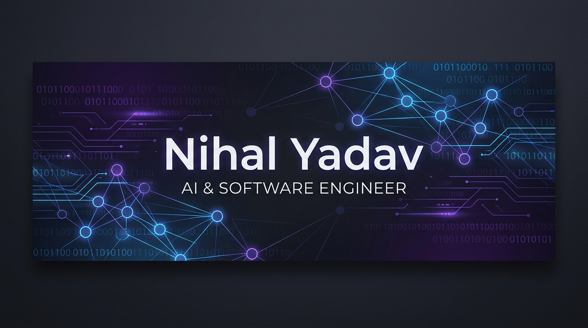

  

<h1 align="center">Hi there, I'm Nihal Yadav! 👋</h1>

  <strong>AI & Software Engineer | Machine Learning Specialist | Full Stack Developer</strong>

  Passionate about designing intelligent, data-driven systems, training robust machine learning models, and building modern, responsive web applications.

  
  

---

### 💫 About Me

- 🎓 **Focus Areas**: Deep Learning, Machine Learning, Agentic AI, and Full Stack Development.
- 🤖 **Agentic AI**: Currently building autonomous fact-checking systems like the **Agentic-News-Verifier**.
- 🌾 **Smart Agriculture**: Leveraging ML to predict crop yields and classify crop diseases using environmental data.
- 🌐 **Web Development**: Creating beautiful, interactive web experiences (like my TypeScript-based E-commerce design and responsive CSS projects).
- ⚙️ **Workflow**: Focused on writing clean, modular, and optimized code.

---

### 🛠️ Tech Stack & Skills

<table>
  <tr>
    <td valign="top" width="50%">
      <h4>💻 Languages & Core Web</h4>
      
      
      
      
      
    </td>
    <td valign="top" width="50%">
      <h4>🧠 Machine Learning & Data Science</h4>
      
      
      
      
    </td>
  </tr>
  <tr>
    <td valign="top" width="50%">
      <h4>🌐 Frameworks & Dev</h4>
      
      
      
    </td>
    <td valign="top" width="50%">
      <h4>⚙️ Tools & Platforms</h4>
      
      
      
      
    </td>
  </tr>
</table>

---

### 🚀 Highlighted Projects

* 📰 **[Agentic-News-Verifier](https://github.com/NIHAL670/Agentic-News-Verifier)** (Python) - An AI-powered fact-checking agent designed to automatically verify news content using advanced agentic workflows.
* 🌾 **[AI-powered Crop Prediction & Disease Detection](https://github.com/NIHAL670/AI-powered-crop-prediction-and-disease-detection-model)** (Python) - Machine learning models for agriculture that predict suitable crops and identify leaf/crop diseases.
* 📈 **[Crop Yield ML Model](https://github.com/NIHAL670/Crop_Yield-ML-Model)** (Python) - An analytical machine learning model to estimate crop production output based on soil chemistry and weather attributes.
* 🪙 **[Crypto Prediction Model](https://github.com/NIHAL670/cryptop_prediction_model)** (Python) - A time-series forecasting model to analyze and predict price trends for cryptocurrencies.
* 🛒 **[Nova E-Cart](https://github.com/NIHAL670/Nova-ecart-)** (TypeScript) - A beautifully-styled and interactive e-commerce shopping cart system.
* 🏋️‍♂️ **[Gym Club Website](https://github.com/NIHAL670/nihal_gym-club)** (CSS/HTML) - A clean, modern gym landing page emphasizing premium typography and layout.
* ☀️ **[Weather App](https://github.com/NIHAL670/weather-app)** (JavaScript) - Interactive weather dashboard consuming external API data for instant forecasts.

---

### 📊 GitHub Stats

  
  &nbsp;&nbsp;&nbsp;&nbsp;&nbsp;&nbsp;&nbsp;&nbsp;&nbsp;&nbsp;
  

---

  🤝 <strong>Let's connect and build something awesome together!</strong> 
  Feel free to reach out via my <a href="mailto:Nihalyadav19876@gmail.com">Email</a> or check out my <a href="https://portfolio-n-beta.vercel.app/">Portfolio Site</a>.

